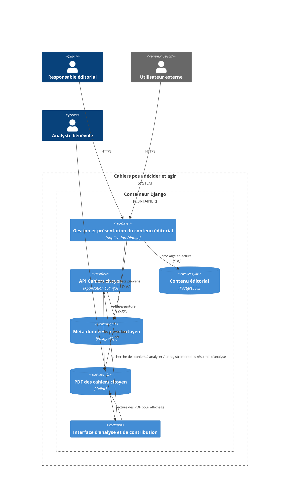

# Architecture

## Description des composants

### Acteurs

L'**utilisateur externe** représente tout utilisateur à l'organisation projet et qui 
accède au site développé pour consulter le contenu éditorial et interagir avec le site.

Le **responsable éditorial** est chargé de la rédaction, de la publication et de la 
gestion du contenu du site. Il s'agit d'un utilisateur enregistré dans le système 
d'authentification du site et qui dispose d'un accès sécurisé et privilégié au contenu
(via l'interface d'administration Django ?)

L'**analyste bénévole** intervient uniquement pendant la saison de construction du projet.
Il s'agit d'un bénévole de l'association D4G qui s'implique sur ce projet pour procéder
à l'analyse des cahiers pré-sélectionnés. Il est notamment chargé, pour chaque cahier 
(fichier PDF) analysé de :

 *  d'enrichir le document PDF de méta-données nécessaires aux traitements et à l'utilisation
 des cahiers de contrôle
 * d'identifier et de marquer les limites de chaque contribution à l'intérieur du cahier
 * de retirer (par caviardage) tout élément ds fichiers PDF permettant d'identifier un individu
 afin de rendre les publications anonymes.

 ### Composants applicatifs

 Les composants applicatifs sont réalisés sous la forme d'applications Django.

 Le composant **Gestion et présentation du contenu éditorial** représente l'application
 centrale du projet. Il est chargé de présenter le contenu éditorial aux utilisateurs externes
 et de gérer les interactions telles que définies par les spécifications.

 Le composant **interface d'analyse et de contribution** sera ouvert uniquement pendant
 la saison 15 D4G. Il permettra aux bénévoles volontaires d'accéder aux données PDF des 
 cahiers citoyens sélectionné et de réaliser les traitements d'analyse de chaque contribution
 pour enrichir les meta-données.

 L'**API Cahiers citoyen** assurer l'interface de lecture et d'écriture par laquelle 
 l'**interface d'analyse et de contribution** accès aux cahiers citoyens à analyser et
 enregistre en retour les meta-données produites par les bénévoles.

 ### Composants de stockage

 Le projet met en oeuvre 3 types de stockage:

 * un stockage **PDF des cahiers citoyen** utilisant le composant `cellar` et permettant
 un accès en ligne et rapide aux cahiers citoyens.
 * un stockage **Contenu éditorial** utilisée par le composant de présentation du contenu
 éditorial pour stocket et accéder aux médias produits (images, video,...)
 * un stockage **Meta-données cahiers citoyen** qui permet de stocker les meta-données
 associées à chaque contribution.