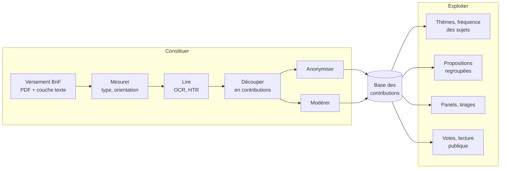

# La chaîne de traitement

Le travail se partage en deux parties, qui avancent chacune de leur côté :

- **Constituer la base des contributions** : des PDF du versement BnF,
  tirer des contributions délimitées, lues, anonymisées et modérées, prêtes
  à être indexées. Cette partie **ajoute** des données à la base.
- **Exploiter la base**, pour l'association : thèmes, propositions
  qui se ressemblent, fréquence des sujets, panels, votes des citoyens sur
  la plateforme. Cette partie **lit** la base.

Entre les deux, la base des contributions, celle de la plateforme ([`plateforme/`](../plateforme/),
application `cahiers`) sert de contrat. Une étape de la première partie peut
s'améliorer sans rien changer à la seconde, du moment qu'elle remplit les
mêmes tables. Une exploitation peut se construire sur les contributions déjà
chargées, sans attendre que tout le corpus le soit.

Les modules sont dans [`analyse/`](../analyse/), sauf mention contraire ;
chacun lit et écrit dans `analyse/data/`, hors git. Une commande par module :
`uv run python -m <module>`, décrite dans sa docstring ou son README.

## La base des contributions

Ce que la base garde de chaque cahier (`plateforme/cahiers/models.py`) :

- le **document** du versement, sa commune (au 1er janvier 2019) et ses
  **pages** : type, rotation, pages de service et d'ouverture. C'est la
  provenance, jamais réécrite ;
- les **transcriptions** des pages, rattachées au run qui les a produites
  (la table existe, aucune commande ne la remplit encore) ;
- les **contributions** : début et fin sur les pages, texte anonymisé,
  extrait caviardé (le seul fichier que le public voit), et `publiable`, faux
  pour ce qui est à écarter.

Une contribution appartient à un **run** : un découpage fait à la main, par
l'édition Chabin, ou par un modèle. Plusieurs runs coexistent ; un seul est
actif. Remplacer un découpage revient donc à charger un nouveau run, pas à
réécrire l'ancien.

## Constituer

| Étape | Modules | Mesure | Où en lire plus |
|---|---|---|---|
| **Mesurer le corpus** : type de chaque page (vierge, dactylographiée, mixte, manuscrite), pages tournées, fichiers concaténés ou incomplets, pages d'ouverture imprimées | `corpus.typage`, `corpus.cascade`, `corpus.orientation`, `corpus.concatenes`, `corpus.inventaires`, `corpus.manquantes`, `corpus.ouvertures`, `corpus.communes` | 276 000 pages écrites : 38 % dactylographiées, 11 % mixtes, 51 % manuscrites | [`docs/corpus.md`](corpus.md), #17, #41, #43 |
| **Lire le texte imprimé** (OCR) | couche texte du versement ; `ocr.chabin`, `ocr.anomalies`, `ocr.modernes`, `ocr.tirage` | 1,5 % d'erreurs par caractère (médiane) ; 0,6 % avec un OCR récent ; ailleurs qu'en Charente-Maritime, 2 % des mots diffèrent d'une relecture par Claude Haiku | [`docs/ocr.md`](ocr.md), #12 |
| **Lire les manuscrits** (HTR) | [`htr/`](../htr/) | Aucun modèle local n'est encore assez fidèle pour publier | [`docs/htr.md`](htr.md), #6 |
| **Découper** les cahiers en contributions | `decoupage.contributions` (règles et modèle), `decoupage.corpus` (les mêmes, sur tout le corpus), `decoupage.vision` (modèle de vision) ; références : `decoupage.delimitation`, `decoupage.chabin`, `decoupage.troncons` | Règles et modèle, pages dactylographiées et mixtes : 75 % des débuts trouvés sont justes, 81 % des débuts sont trouvés. Qwen servi en Europe, toutes pages : 81 % et 84 % | [`analyse/decoupage/contributions/`](../analyse/decoupage/contributions/), #5, #64 |
| **Anonymiser** | `anonymisation` et ses sous-modules ; étalon `anonymisation.aude` | Texte seul : 92 à 94 % des données cachées ; image et modèle de vision : 88 à 89 % | [`docs/anonymisation.md`](anonymisation.md), #7, #128 |
| **Modérer** : écarter les contenus haineux ou illicites | Aucun : à la main, dans l'outil d'annotation (« à écarter ») | Pas d'étalon ; un modèle de vision peut préparer une relecture, pas trancher | #166 |
| **Charger** dans la base | `manage.py charger_corpus`, `charger_contributions`, `charger_extraits`, `charger_chabin` ([`plateforme/`](../plateforme/)) | — | [`plateforme/README.md`](../plateforme/README.md), #34 |

La lecture des manuscrits est un sous-projet à part, [`htr/`](../htr/),
pour une raison technique : kraken demande Python 3.12 et numpy 1, quand
`analyse/` est en Python 3.14 et numpy 2. Les modules `ocr` restent dans
`analyse/` : ils mesurent la couche texte du versement et interrogent des
modèles servis ailleurs, sans dépendance lourde.

Aujourd'hui, la base ne contient que les contributions délimitées à
la main (les cahiers des 100 contributions tirées) et celles de l'édition
Chabin. Le découpage et l'anonymisation automatiques sont mesurés, mais leurs
sorties ne sont pas encore chargées.

L'outil d'annotation (`annotation`) sert à toute la constitution : c'est là
qu'on note, à la main, les vérités terrain contre lesquelles tout est mesuré
(types de page, débuts de contributions, données personnelles, pages à
écarter).

## Exploiter

| Usage | Modules | État | Où en lire plus |
|---|---|---|---|
| **Thèmes** : rattacher chaque contribution aux thèmes de l'association, compter la place de chaque sujet | `classement.themes` | Grille V2 (8 thèmes, 42 sous-thèmes), repérage par mots-clés | #24 |
| **Types de discours** : témoignage, constat, revendication, proposition… | — | Typologie proposée | #25 |
| **Propositions regroupées** : retrouver la même idée d'un cahier à l'autre | `classement.propositions`, `classement.paires`, `classement.paires.accord` | Étalon de paires en cours d'annotation | #4, #94 |
| **Panels et tirages** : des contributions représentatives des habitants | `panels.tirage`, `panels.panel`, `corpus.communes.representativite` ; `panels.selection` et `panels.recueil` pour les exporter | 100 contributions tirées, exportées et réunies en recueil | [`docs/selection.md`](selection.md), #21, #22 |
| **Plateforme publique** : lire, voter, s'informer | [`plateforme/`](../plateforme/) | Page d'accueil qui tire une contribution au sort ; votes à venir | #29, #30, #38 |

Les modules d'exploitation lisent encore les sorties d'`analyse/` (par
exemple `classement.themes` lit `data/delimitation/`) plutôt que la base. À mesure que
la base s'étoffe, ils devraient la lire directement.

## Avec et sans LLM

Chaque étape a une variante sans LLM : règles, régression, petits modèles
qui tiennent sur un processeur ou une petite carte (GLiNER, 200 M de
paramètres ; OCR de moins d'un milliard). La variante LLM passe par un gros
modèle : Qwen3.8-27B ou Gemma 4 31B, servis en Europe, ou Claude Haiku,
hébergé aux États-Unis et réservé aux pages et textes déjà anonymisés. Quand
les deux variantes sont mesurées, c'est sur le même étalon, au 27 octobre 2026.

| Étape | Étalon | Sans LLM | Avec LLM |
|---|---|---|---|
| Lire l'imprimé | Chabin, erreurs par caractère (médiane) | ABBYY 1,5 %, Tesseract 1,7 % ; OvisOCR3 (0,8 Md) 0,6 % | Inutile : un petit OCR lit déjà presque sans faute |
| Lire les manuscrits | Chabin, erreurs par caractère | kraken : 28 % au mieux, illisible | Gemma 4 31B 6,4 %, Claude Haiku 5,4 % ; Chabin elle-même 2,8 % |
| Découper, pages imprimées | 25 cahiers délimités, 165 pages | Règles et régression : précision 83 %, rappel 84 % | Qwen vérifié 79 % et 98 % ; Haiku 85 % et 98 % |
| Découper, toutes pages | Les mêmes cahiers, 374 pages | Rappel 26 % : rien sur les manuscrits, sans texte | Qwen vérifié 81 % et 84 % ; Haiku 90 % et 84 % |
| Anonymiser, texte seul | 93 cahiers délimités, données encadrées | Règles, liste blanche et zones : 89 % couvertes, 12 % des autres mots cachés ; avec GLiNER, 92 % | Pas mesuré : la vision travaille sur l'image |
| Anonymiser, texte seul | Aude, 223 pages dactylographiées, masques des Archives (sans zones de signature) ; un masque est couvert quand ses mots de la couche texte sont cachés | Règles et liste blanche : 80 % couverts, 7 % des autres mots cachés ; avec GLiNER, 83 % | Vision seule : 91 % couverts, 1 % caché |
| Anonymiser, image | Aude, masques des Archives, encre comprise | Règles, modèle et encre : 91 % couverts, mais 20 % des mots cachés sur les pages dactylographiées et 92 % sur les manuscrites | Vision seule : 88 % (dactylographiées) et 89 % (manuscrites), pour 1 à 2 % cachés |
| Thèmes, chaîne entière | 1 488 contributions délimitées | Mots-clés sur le corpus anonymisé : la place de chaque sous-thème suit la main (corrélation 0,97) | — |
| Thèmes, repérage | 300 contributions de l'édition Chabin, tirées au hasard ; accord entre les deux, sans annotation humaine | Mots-clés : 6,0 sous-thèmes par contribution | Claude Haiku : 5,7 ; deux sur trois en commun avec les mots-clés, kappa médian 0,46 |

Deux mesures sont ponctuelles, faites hors des modules : le texte seul sur
l'Aude et le repérage par Haiku. Les autres se refont avec la commande de
leur module.

Ce que ça dit :

- **Sur l'imprimé, la chaîne sans LLM lit et découpe aussi bien.** Les
  LLM trouvent plus de débuts de contributions (98 % contre 84 %), pas plus
  justes. Les pages imprimées font la moitié des pages écrites (38 %
  dactylographiées, 11 % mixtes).
- **Pour anonymiser, la vision fait mieux.** Sur les pages dactylographiées
  de l'Aude, elle couvre 91 % des masques contre 80 à 83 % sans LLM, et cache
  sept fois moins de texte.
- **Pour les thèmes, les deux repérages s'accordent sur les sujets
  concrets** (ISF, vote blanc, RIC, salaires et retraites, immigration :
  kappa de 0,75 à 0,99) **et divergent sur les sujets larges** (école, place
  des citoyens, répartition de l'impôt : 0,27 à 0,31). Rien ne dit encore lequel a
  raison : seule une annotation humaine des désaccords le tranchera.
- **Sur les manuscrits, rien ne remplace un gros modèle.** Sans texte, les
  règles ne découpent rien et la liste blanche n'a rien à garder ; l'encre
  cache presque toute l'écriture. Même avec un LLM, aucun modèle servi en
  Europe ne lit assez fidèlement pour publier ([`docs/htr.md`](htr.md)).
- **Une limite.** Les 25 cahiers du découpage viennent des délimités, sur
  lesquels les règles ont été réglées : sur les tronçons, départements jamais
  vus, elles tombent à 52 % et 61 % (sur 21 débuts seulement), et les LLM
  n'y sont pas mesurés, car leurs pages ne sont pas caviardées.
- **Le coût.** L'anonymisation par la vision demanderait environ 440 heures
  d'A100 pour le corpus avec les deux modèles ; l'anonymisation en texte
  seul, sans LLM, tourne en quelques minutes sur un processeur.

## Les références

Chaque mesure se fait contre un travail humain :

- **Les cahiers délimités** : les cahiers des 100 contributions tirées,
  délimités en entier dans l'outil d'annotation (`decoupage.delimitation`). Référence
  du découpage et de l'anonymisation des pages imprimées. Le tirage les a
  choisis : c'est le seul endroit où l'exploitation a nourri la constitution.
- **Les tronçons** (`decoupage.troncons`) : dix pages dans chacun des départements que
  les cahiers délimités ne couvrent pas. Jeu de test du découpage, à ne pas
  regarder pour régler les règles.
- **L'édition Chabin** : les cahiers de Charente-Maritime transcrits et
  anonymisés par Marie-Anne Chabin ([`extraction/`](../extraction/)).
  Référence du découpage, de l'OCR, de la HTR et de l'anonymisation.
- **L'Aude** : les cahiers caviardés par les Archives départementales
  (`anonymisation.aude`, `anonymisation.aude.etalon`). Seul étalon d'anonymisation avec des manuscrits.
- **Dole** : une transcription XML-TEI de manuscrits, étalon de la HTR.

## Lexique

- **Versement** : les PDF des cahiers déposés à la BnF, un dossier par
  département (`BnF_GDN_XX_PDF`).
- **Base des contributions** : la base de la plateforme, où la constitution
  écrit les contributions délimitées, anonymisées et modérées, et où
  l'exploitation les lit. Elle garde aussi ce qui ne sera pas publié
  (contributions à écarter, pages non anonymisées pour les administrateurs).
- **Cahier** : un fichier du versement ; une **contribution** : le texte d'un
  auteur (ou d'un groupe) dans un cahier ; une **proposition** : une idée
  dans une contribution.
- **Run** : une production de la chaîne (un découpage, une transcription),
  datée, avec son auteur ou son modèle et ses paramètres.
- **Découpage** : trouver où commence chaque contribution d'un cahier
  (`decoupage.contributions`). À ne pas confondre avec le découpage d'une contribution
  en propositions (`classement.propositions`).
- **Délimiter** : faire le découpage à la main, dans l'outil d'annotation.
- **Page mixte** : une page imprimée remplie à la main (un formulaire, le plus
  souvent). Sa couche texte lit l'imprimé, pas l'écriture.
- **Chabin** : trois modules portent ce nom. `extraction/chabin` télécharge
  et extrait l'édition ; `analyse/decoupage/chabin` en fait une référence de
  découpage ; `ocr.chabin` y mesure l'OCR.
- **Tirage** et **sélection** : le tirage choisit les 100 contributions
  (`panels.tirage`) ; la sélection les exporte, caviardées, une fois leur cahier
  délimité (`panels.selection`).
