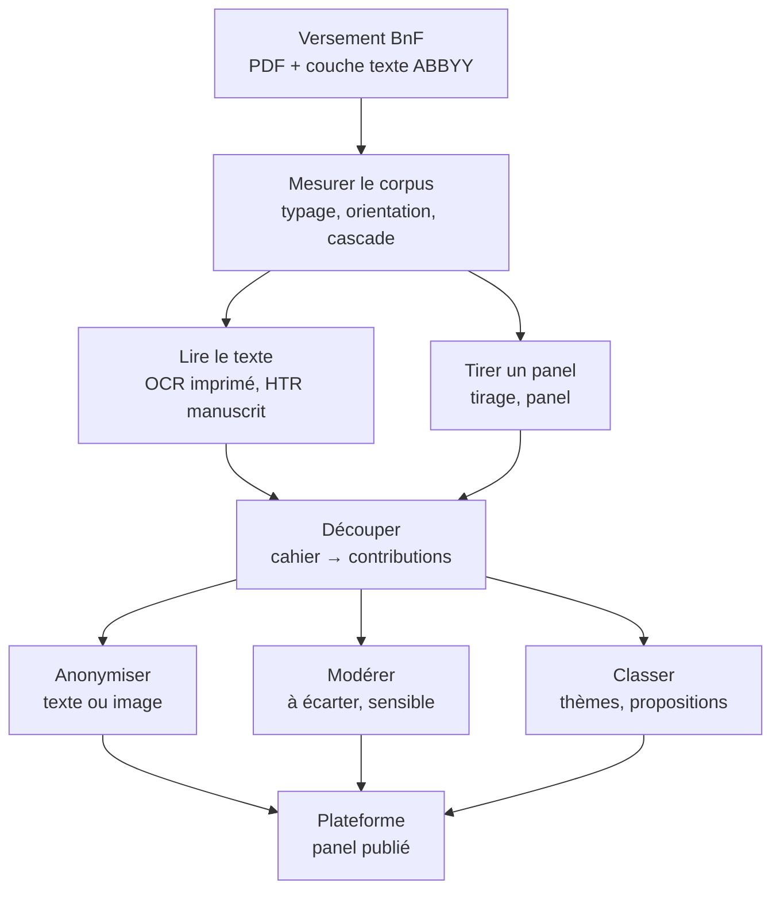

# La chaîne de traitement

Des PDF du versement BnF aux contributions montrées sur la plateforme. Cette
page dit dans quel ordre s'enchaînent les étapes, quel module fait chacune,
et où en est sa mesure ; le détail est dans la page de chaque étape.

Les modules sont dans [`analyse/`](../analyse/), sauf mention contraire ;
chacun lit et écrit dans `analyse/data/`, hors git. Une commande par module :
`uv run python -m <module>`, décrite dans sa docstring ou son README.

## Les étapes

| Étape | Modules | Mesure | Où en lire plus |
|---|---|---|---|
| **Mesurer le corpus** : type de chaque page (vierge, dactylographiée, mixte, manuscrite), pages tournées, fichiers concaténés ou incomplets, pages d'ouverture imprimées | `typage`, `cascade`, `orientation`, `concatenes`, `inventaires`, `manquantes`, `ouvertures`, `communes` | 276 000 pages écrites, dont 142 000 manuscrites | [`analyse/cascade/`](../analyse/cascade/), #17, #41, #43 |
| **Tirer un panel** représentatif des habitants | `tirage`, `panel`, `communes.representativite` | 100 contributions tirées ; leurs cahiers délimités en entier | [`docs/selection.md`](selection.md), #21, #22 |
| **Lire le texte imprimé** (OCR) | couche texte du versement ; `ocr.chabin`, `ocr.anomalies`, `ocr.modernes` | 1,5 % d'erreurs par caractère (médiane) ; 0,6 % avec un OCR récent | [`docs/ocr.md`](ocr.md), #12 |
| **Lire les manuscrits** (HTR) | [`htr/`](../htr/) | Aucun modèle local n'est encore assez fidèle pour publier | [`docs/htr.md`](htr.md), #6 |
| **Découper** les cahiers en contributions | `contributions` (règles et modèle) ; références : `delimitation`, `chabin`, `troncons` | Pages dactylographiées et mixtes : 75 % des débuts trouvés sont justes, 81 % des débuts sont trouvés ; les manuscrits ne sont pas découpés | [`analyse/contributions/`](../analyse/contributions/), #5, #64 |
| **Anonymiser** | `anonymisation` et ses sous-modules ; étalon `aude` | Texte seul : 92 à 94 % des données cachées ; image et modèle de vision : 88 à 89 % | [`docs/anonymisation.md`](anonymisation.md), #7, #128 |
| **Modérer** : écarter les contenus haineux ou illicites | Aucun : à la main, dans l'outil d'annotation (« à écarter ») | Pas d'étalon | #166 |
| **Classer** : thèmes, types de discours, propositions semblables | `themes`, `propositions`, `paires` | Thèmes repérés par mots-clés ; étalon de regroupement en cours | #4, #24, #25, #94 |
| **Publier** | [`plateforme/`](../plateforme/) (Django) ; `selection` et `recueil` pour les 100 contributions tirées | Charge les cahiers, les contributions délimitées et leurs extraits caviardés | [`plateforme/README.md`](../plateforme/README.md), #29, #34 |

L'outil d'annotation (`annotation`) sert à toutes les étapes : c'est là
qu'on note, à la main, les vérités terrain contre lesquelles tout est mesuré
(types de page, débuts de contributions, données personnelles, pages à
écarter, paires de propositions).

## Les références

Chaque mesure se fait contre un travail humain :

- **Les cahiers délimités** : les cahiers des 100 contributions tirées,
  délimités en entier dans l'outil d'annotation (`delimitation`). Référence
  du découpage et de l'anonymisation des pages imprimées.
- **Les tronçons** (`troncons`) : dix pages dans chacun des départements que
  les cahiers délimités ne couvrent pas. Jeu de test du découpage, à ne pas
  regarder pour régler les règles.
- **L'édition Chabin** : les cahiers de Charente-Maritime transcrits et
  anonymisés par Marie-Anne Chabin ([`extraction/`](../extraction/)).
  Référence du découpage, de l'OCR, de la HTR et de l'anonymisation.
- **L'Aude** : les cahiers caviardés par les Archives départementales
  (`aude`, `aude.etalon`). Seul étalon d'anonymisation avec des manuscrits.
- **Dole** : une transcription XML-TEI de manuscrits, étalon de la HTR.

## Lexique

- **Versement** : les PDF des cahiers déposés à la BnF, un dossier par
  département (`BnF_GDN_XX_PDF`).
- **Cahier** : un fichier du versement ; une **contribution** : le texte d'un
  auteur (ou d'un groupe) dans un cahier ; une **proposition** : une idée
  dans une contribution.
- **Découpage** : trouver où commence chaque contribution d'un cahier
  (`contributions`). À ne pas confondre avec le découpage d'une contribution
  en propositions (`propositions`).
- **Délimiter** : faire le découpage à la main, dans l'outil d'annotation.
- **Page mixte** : une page imprimée remplie à la main (un formulaire, le plus
  souvent). Sa couche texte lit l'imprimé, pas l'écriture.
- **Chabin** : trois modules portent ce nom. `extraction/chabin` télécharge
  et extrait l'édition ; `analyse/chabin` en fait une référence de
  découpage ; `ocr.chabin` y mesure l'OCR.
- **Tirage** et **sélection** : le tirage choisit les 100 contributions
  (`tirage`) ; la sélection les exporte, caviardées, une fois leur cahier
  délimité (`selection`).
