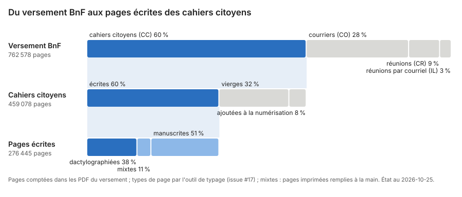

# Le corpus : du versement aux pages écrites

Ce que devient chaque page numérisée du versement BnF, niveau par niveau :
combien de pages le versement contient, combien relèvent des cahiers
citoyens, combien sont vraiment écrites, et comment.



## Les niveaux

1. **Versement BnF** : toutes les pages des PDF, par catégorie de la BnF :
   cahiers citoyens (CC), courriers (CO), comptes rendus de réunions (CR) et
   réunions par courriel (IL). Les inventaires et documents
   d'accompagnement (`A_lire/`) sont exclus.
2. **Cahiers citoyens** : les pages ajoutées à la numérisation
   (intercalaires, pages de garde) et les pages vierges sont écartées.
3. **Pages écrites** : dactylographiées, mixtes ou manuscrites.

## Le type des pages

Le typage (`analyse/corpus/typage`, #17) lit deux signaux dans le PDF, sans
refaire d'OCR : la part d'encre de la page, et la part de mots français
connus dans sa couche texte.

- **Vierge** : presque pas d'encre.
- **Manuscrite** : de l'encre, mais pas de couche texte lisible.
- **Dactylographiée** : une couche texte lisible, qui couvre l'encre de la
  page. Signatures, coordonnées, tampons et annotations à la main n'en
  changent pas le type.
- **Mixte** : une page imprimée remplie à la main, le plus souvent un
  formulaire (AMIF, mairies, Ville de Paris…). Sa couche texte lit
  l'imprimé ; l'écriture à la main est à lire autrement (HTR, encre,
  vision). Le signal est la part de l'encre hors des mots connus de la
  couche texte.

Le 25 octobre 2026, le typage a été corrigé : il ne rendait une page mixte
que sur un gabarit de formulaire reconnu. 23 454 pages dactylographiées
sont passées en mixtes, surtout à Paris et dans les Hauts-de-Seine
(détail dans [`ocr.md`](ocr.md#le-typage-corrigé)).

## Limites

- Seuls les cahiers citoyens sont typés. Les courriers (CO) sont dans le
  périmètre des doléances, mais leurs pages ne sont pas encore typées ; CR et
  IL sont hors périmètre.
- Vérification à la main sur 100 pages tirées au hasard : aucune page vierge
  manquée (0 sur 48), 2 inversions entre dactylographiée et manuscrite. Pour
  les pages mixtes, sur 102 pages dactylographiées des cahiers délimités :
  40 des 43 pages mixtes trouvées, 4 fausses alertes.
- Une page tournée d'un quart de tour a une couche texte qui n'est que du
  bruit (`analyse/corpus/orientation`).

## Les autres mesures du corpus

Dans [`analyse/`](../analyse/), même étape de la chaîne
([`chaine.md`](chaine.md)) : pages tournées (`corpus.orientation`), fichiers qui
contiennent le cahier d'une autre commune (`corpus.concatenes`), documents
inventoriés sans fichier (`corpus.inventaires`), pages manquantes des courriers
types (`corpus.manquantes`), pages d'ouverture imprimées (`corpus.ouvertures`), communes
et leurs variables INSEE (`corpus.communes`).

## Refaire la figure

Depuis `analyse/` :

```bash
uv run python -m corpus.typage <racine du versement>/B[nN][fF]_GDN_*_PDF/CC --sortie data/typage/pages.csv
uv run python -m corpus.cascade <racine du versement> --typage data/typage/pages.csv
```

La figure, `docs/cascade.svg`, est versionnée : elle ne contient que des
comptes. Le détail des commandes est dans
[`analyse/corpus/cascade/`](../analyse/corpus/cascade/).
