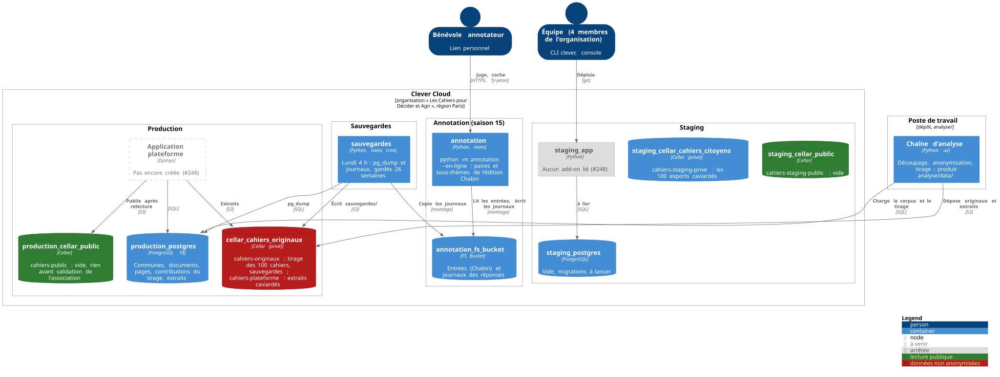

# Déploiement sur Clever Cloud

État au 13 novembre 2026. L'architecture cible de la plateforme est dans
[`architecture.md`](architecture.md) ; ici, ce qui tourne vraiment.

Source : [`deploiement.puml`](deploiement.puml), rendu avec
`plantuml -tsvg` (image `docker.io/plantuml/plantuml:1.2025.10`).

## Ce qu'il faut savoir

- **Une organisation**, « Les Cahiers pour Décider et Agir », région Paris.
  Les quatre membres y ont accès ; les identifiants des add-ons se lisent
  avec `clever addon env <add-on> -F shell`, jamais dans le dépôt.
- **Les Cellar sont cloisonnés** : les clés de l'un n'ouvrent pas les autres.
  Ne pas lier deux Cellar à la même application, leurs variables
  `CELLAR_ADDON_*` entreraient en collision.
- **En rouge, les données non anonymisées** : `cellar_cahiers_originaux` ne
  sert qu'à la chaîne d'analyse et aux sauvegardes.
- **En vert, la lecture publique** : rien n'y entre avant validation de
  l'association.
- **Le staging** ne reçoit que l'édition Chabin, des données fictives ou les
  exports caviardés.
- **La plateforme** n'a pas encore d'application de production (#248). Avec
  Cellar, boto3 demande `AWS_REQUEST_CHECKSUM_CALCULATION=when_required` et
  `AWS_RESPONSE_CHECKSUM_VALIDATION=when_required`.
- **L'annotation en ligne** ne sert que les paires et les sous-thèmes de
  l'édition Chabin, avec un lien par annotateur
  ([`analyse/annotation/README.md`](../analyse/annotation/README.md#en-ligne)).
- **Les sauvegardes** : chaque lundi à 4 h, un `pg_dump` de la production et
  les journaux d'annotation vont dans `cahiers-originaux/sauvegardes/`,
  gardés 26 semaines. S'y ajoutent les sauvegardes quotidiennes de Clever
  Cloud (7 jours). Un échec ne se voit que dans la console Clever.
