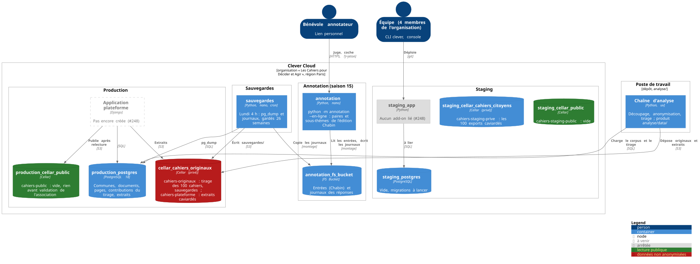
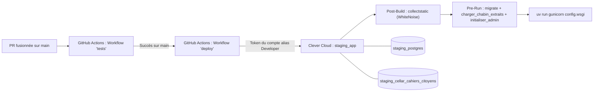

# Déploiement sur Clever Cloud

État au 13 novembre 2026. L'architecture cible de la plateforme est dans
[`architecture.md`](architecture.md) ; ici, ce qui tourne vraiment.



Source : [`deploiement.puml`](deploiement.puml), rendu avec
`plantuml -tsvg` (image `docker.io/plantuml/plantuml:1.2025.10`).

## Ce qu'il faut savoir

- **Une organisation**, « Les Cahiers pour Décider et Agir », région Paris.
  Les quatre membres y ont accès ; les identifiants des add-ons se lisent
  avec `clever addon env <add-on> -F shell`, jamais dans le dépôt.
- **Les Cellar sont cloisonnés** : les clés de l'un n'ouvrent pas les autres.
  Ne pas lier deux Cellar à la même application, leurs variables
  `CELLAR_ADDON_*` entreraient en collision.
- **En rouge, les données non anonymisées** : `cellar_cahiers_originaux` ne
  sert qu'à la chaîne d'analyse et aux sauvegardes.
- **En vert, la lecture publique** : rien n'y entre avant validation de
  l'association.
- **Le staging** ne reçoit que l'édition Chabin, des données fictives ou les
  exports caviardés.
- **La plateforme** n'a pas encore d'application de production (#248). Avec
  Cellar, boto3 demande `AWS_REQUEST_CHECKSUM_CALCULATION=when_required` et
  `AWS_RESPONSE_CHECKSUM_VALIDATION=when_required`.
- **L'annotation en ligne** ne sert que les paires et les sous-thèmes de
  l'édition Chabin, avec un lien par annotateur
  ([`analyse/annotation/README.md`](../analyse/annotation/README.md#en-ligne)).
- **Les sauvegardes** : chaque lundi à 4 h, un `pg_dump` de la production et
  les journaux d'annotation vont dans `cahiers-originaux/sauvegardes/`,
  gardés 26 semaines. S'y ajoutent les sauvegardes quotidiennes de Clever
  Cloud (7 jours). Un échec ne se voit que dans la console Clever.

## Plan de déploiement plateforme (en cours)

Ce plan décrit le déploiement continu de l'application Django (`plateforme/`) vers l'environnement **STAGING** sur Clever Cloud (et le déploiement manuel vers **PROD**), en s'appuyant sur les ressources existantes de l'organisation **« Les Cahiers pour Décider et Agir »** :
- Application Python : **`staging_app`**
- Add-on PostgreSQL : **`staging_postgres`**
- Add-on Cellar (S3 privé) : **`staging_cellar_cahiers_citoyens`** (bucket : `cahiers-staging-prive`)



### 1. Architecture des fichiers statiques et médias

#### Fichiers statiques (`STATIC` : CSS, polices, icônes, admin Django)
- **Stockage** : Embarqués dans le conteneur de `staging_app` (pas sur Cellar).
- **Build** : Le hook `CC_POST_BUILD_HOOK="uv run python manage.py collectstatic --noinput"` assemble les fichiers dans `plateforme/staticfiles/`.
- **Service HTTP** : Le middleware **WhiteNoise** (`CompressedStaticFilesStorage`) sert directement les fichiers statiques depuis l'application Django avec compression gzip/brotli.

#### Fichiers médias (`MEDIA` : PDF et extraits caviardés)
- **Stockage** : Le disque de l'instance Clever Cloud étant éphémère, les médias vont sur l'add-on Cellar **`staging_cellar_cahiers_citoyens`** (bucket `cahiers-staging-prive`).
- **Attention** : Ne jamais lier un second add-on Cellar (`staging_cellar_public`) à `staging_app`, car leurs variables `CELLAR_ADDON_*` entreraient en collision.
- **Configuration automatique** : Dès que `CELLAR_ADDON_HOST` est présent, `plateforme/config/settings.py` active `storages.backends.s3.S3Storage` en mode privé (liens signés expirant au bout de 10 minutes).
- **Compatibilité `boto3` avec Cellar** : `boto3` requiert `AWS_REQUEST_CHECKSUM_CALCULATION=when_required` et `AWS_RESPONSE_CHECKSUM_VALIDATION=when_required`.

### 2. Récapitulatif des variables d'environnement Clever Cloud

#### Variables à définir sur `staging_app`

| Variable | Valeur en STAGING | Rôle |
| :--- | :--- | :--- |
| `DJANGO_ENV` | `STAGING` | Active le mode pré-production (`DEBUG=False`, cookies sécurisés, HSTS) |
| `APP_FOLDER` | `plateforme` | Indique à Clever Cloud le sous-dossier de l'application dans le monorepo |
| `CC_PYTHON_UV_RUN_COMMAND` | `uv run gunicorn config.wsgi` | Commande de démarrage du serveur WSGI (écoute sur `PORT`) |
| `CC_POST_BUILD_HOOK` | `uv run python manage.py collectstatic --noinput` | Rassemble les fichiers statiques pour WhiteNoise |
| `CC_PRE_RUN_HOOK` | `uv run python manage.py migrate --noinput && uv run python manage.py charger_chabin_extraits && uv run python manage.py initialiser_admin` | Exécute les migrations, charge les extraits Chabin et initialise l'admin |
| `DJANGO_SECRET_KEY` | `<chaîne-aléatoire-longue>` | Clé cryptographique Django |
| `DJANGO_ALLOWED_HOSTS` | `<domaine-staging>.cleverapps.io` | Domaines autorisés (séparés par des virgules) |
| `DJANGO_SUPERUSER_USERNAME` | `admin` | Identifiant du compte superutilisateur initial |
| `DJANGO_SUPERUSER_EMAIL` | `admin@decider-agir.fr` | Courriel du superutilisateur |
| `DJANGO_SUPERUSER_PASSWORD` | `<mot-de-passe-fort>` | Mot de passe du superutilisateur |
| `CELLAR_BUCKET` | `cahiers-staging-prive` | Nom du bucket Cellar privé pour les médias |
| `AWS_REQUEST_CHECKSUM_CALCULATION` | `when_required` | Requis par `boto3` pour la compatibilité S3 Cellar |
| `AWS_RESPONSE_CHECKSUM_VALIDATION` | `when_required` | Requis par `boto3` pour la compatibilité S3 Cellar |

#### Variables injectées automatiquement par les add-ons liés
- Par **`staging_postgres`** : `POSTGRESQL_ADDON_URI`
- Par **`staging_cellar_cahiers_citoyens`** : `CELLAR_ADDON_HOST`, `CELLAR_ADDON_KEY_ID`, `CELLAR_ADDON_KEY_SECRET`

### 3. Commandes de configuration Clever Cloud (à exécuter une fois depuis un poste)

```sh
# 1. Lier le répertoire local à l'application existante staging_app
clever link staging_app --org "Les Cahiers pour Décider et Agir" --alias staging

# 2. Lier les add-ons PostgreSQL et Cellar privé à staging_app
clever service link-addon staging_postgres --alias staging
clever service link-addon staging_cellar_cahiers_citoyens --alias staging

# 3. Activer Force HTTPS sur le routeur Clever Cloud
clever config update --alias staging --force-https enabled

# 4. Définir les variables d'environnement
clever env set DJANGO_ENV "STAGING" --alias staging
clever env set DJANGO_SECRET_KEY "$(uv run --directory plateforme python -c 'from django.core.management.utils import get_random_secret_key; print(get_random_secret_key())')" --alias staging
clever env set DJANGO_ALLOWED_HOSTS "<domaine-de-staging_app>.cleverapps.io" --alias staging
clever env set APP_FOLDER "plateforme" --alias staging
clever env set CC_POST_BUILD_HOOK "uv run python manage.py collectstatic --noinput" --alias staging
clever env set CC_PRE_RUN_HOOK "uv run python manage.py migrate --noinput && uv run python manage.py charger_chabin_extraits && uv run python manage.py initialiser_admin" --alias staging
clever env set CC_PYTHON_UV_RUN_COMMAND "uv run gunicorn config.wsgi" --alias staging
clever env set DJANGO_SUPERUSER_USERNAME "admin" --alias staging
clever env set DJANGO_SUPERUSER_EMAIL "admin@decider-agir.fr" --alias staging
clever env set DJANGO_SUPERUSER_PASSWORD "<mot-de-passe-fort>" --alias staging
clever env set CELLAR_BUCKET "cahiers-staging-prive" --alias staging
clever env set AWS_REQUEST_CHECKSUM_CALCULATION "when_required" --alias staging
clever env set AWS_RESPONSE_CHECKSUM_VALIDATION "when_required" --alias staging
```

### 4. Sécurisation du déploiement GitHub Actions (compte alias `Developer`)

1. Inviter un compte alias (ex. `votre-email+ci@...`) avec le rôle **`Developer`** dans l'organisation Clever Cloud **« Les Cahiers pour Décider et Agir »**.
2. Se connecter avec ce compte alias et générer un token :
   ```sh
   clever tokens create "github-actions-ci"
   ```
3. Dans GitHub (**Settings > Environments > New environment : `staging`**) :
   - **Deployment branches** : sélectionner *Selected branches* → `main` uniquement.
   - **Secrets** : `CLEVER_TOKEN` et `CLEVER_SECRET`.
   - **Variables** : `CLEVER_APP_ID` (identifiant `app_...` de `staging_app`).
4. Activer *Require review from Code Owners* dans les règles de protection de la branche `main` (s'appuie sur `.github/CODEOWNERS` avec `@jpmjpmjpm`, `@njouanin` et `@HugoFara`).
5. Le workflow `.github/workflows/deploy.yaml` déploie automatiquement sur `staging_app` dès que le workflow `tests` réussit sur `main`, et permet un déploiement manuel (`workflow_dispatch`) vers `staging` ou `production`.

### 5. Comptes d'administration

Cette section ne concerne que le compte développeur. Les rôles de l'administration Wagtail et la procédure d'accueil d'une personne sont décrits dans [`administration.md`](administration.md).

- **Le compte développeur (identifiant `admin`) est recréé au démarrage s'il manque**, par `initialiser_admin`, à partir de `DJANGO_SUPERUSER_*`. Il a tous les droits, sur tous les comptes, dans l'administration Wagtail (`/admin/`) comme dans l'administration Django (`/django-admin/`).
- **Seules les personnes qui ont déjà accès à la console Clever Cloud détiennent ce compte.** La frontière de sécurité est l'accès à Clever Cloud et aux secrets GitHub, pas une règle Django :
  - la console donne l'URL de la base, ce qui permet de modifier n'importe quel compte ;
  - elle donne aussi la `SECRET_KEY`, ce qui permet de fabriquer un lien de réinitialisation valide.
- **Un autre développeur qui a besoin de l'administration Django** reçoit un compte personnel aux droits limités. Le détenteur du compte développeur le crée dans l'administration Django :
  - il coche « Statut équipe », mais pas « Statut superutilisateur » ;
  - il ne lui accorde que les permissions sur les modèles métier (`cahiers`, `territoires`).

  Ce compte ne voit aucun utilisateur et n'entre pas dans l'administration Wagtail.
- **Les administrateurs Wagtail sont créés par un développeur**, connecté avec le compte développeur, une seule fois par environnement. Aucun administrateur Wagtail n'est provisionné au déploiement.
